<div align="center">


# Outback Safe

**Know the road before you go.**<br>
Plan an Australian road trip and see which hazards wait on your route, month by month.

<br>

[](https://outback-safe.vercel.app)


<br>

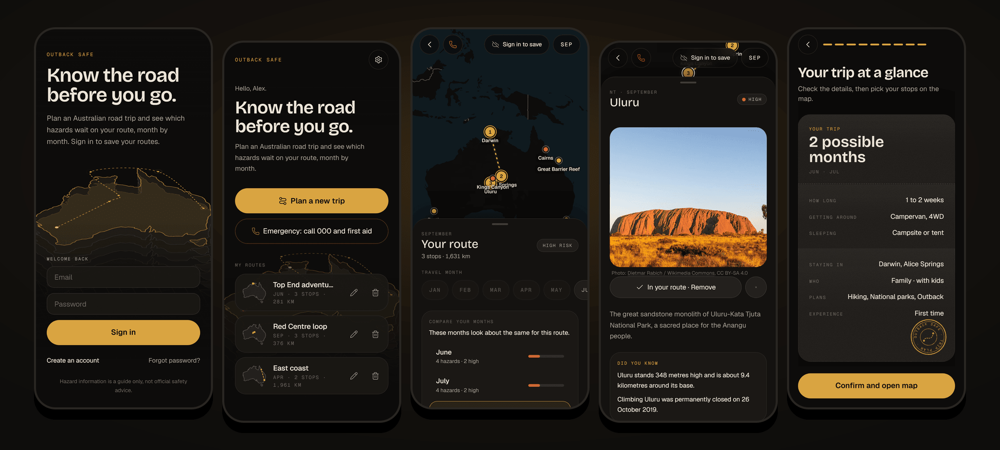

</div>

<br>

<details open>
<summary><b>🇬🇧&nbsp; English</b></summary>

<br>

## About

**Outback Safe** is a dark, calm, mobile-first web app (installable as a PWA) for people who want to drive through Australia and know what to expect. You answer a few questions about your trip, pick stops on a map, and the app shows the hazards that matter for **your** month, **your** way of travelling and **your** plans: from saltwater crocodiles and stinger season in the tropical north to heat, bushfires and empty roads in the Red Centre.

Every hazard is explained in plain language, says what to do, links its public sources, and the whole trip is boiled down to a simple risk score you can compare across months.

> [!WARNING]
> **Not official safety advice.** Hazard information is a guide based on public sources (listed on every hazard). Always follow local signs, rangers and emergency services. In Australia the emergency number is **000**.

## Highlights

- **Trip questionnaire** with eight short questions: months, length, transport, accommodation, base cities, who travels (with a follow-up for children), activities and experience. It ends in a tri-fold letter that unfolds in 3D and gets stamped.
- **Interactive dark map** (MapLibre) with 62 places across five states and territories. Tap to add stops, see the dotted route, and zoom in to reveal more pins. Overlapping pins are thinned out automatically.
- **Hazards that fit your trip.** 14 hazards, each with severity, active months, what to do, first aid and sources. They are filtered by month, transport, activities and where you sleep.
- **Risk ring and month comparison.** One score for the whole route, plus a side-by-side comparison of every month you could travel, with the best month marked.
- **Place pages** with a photo, credit, fun facts, access notes and sourced walking-track facts (distance, time, grade).
- **Ideas near your base city.** Day trips and walks, sorted by who they suit.
- **Travelling with children.** Choosing "Family" asks whether kids come along and adds sourced child-specific advice to the hazards where an official source says something.
- **Saved routes.** Sign in with email and password, and routes save themselves a moment after your last change.
- **Emergency screen** with a one-tap call to 000 and first-aid steps for crocodile attacks, snake bites, stings, heatstroke, bushfires and rip currents.
- **Works offline.** A hand-written service worker caches the app, so routes, hazards and the emergency screen work without a connection.
- **Premium motion** built with CSS 3D and `motion` (no WebGL): a breathing paper-layer Australia on the login and home screens, a camera dive after signing in, and the unfolding letter. Respects `prefers-reduced-motion`.

## Screenshots

<div align="center">

### Getting started

<table>
  <tr>
    <td align="center">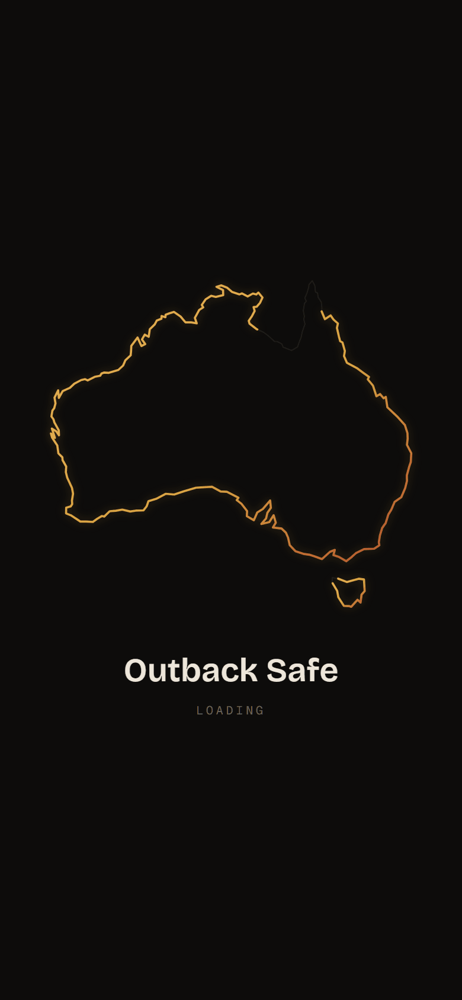<br><b>Intro</b><br><small>Australia draws itself</small></td>
    <td align="center">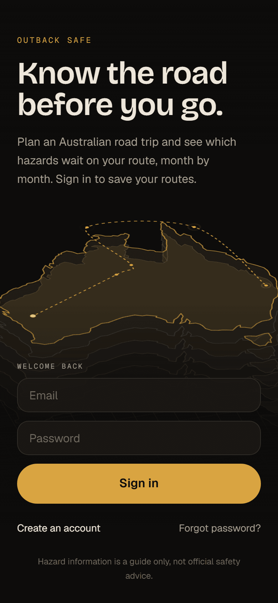<br><b>Sign in</b><br><small>Layered relief, floating route</small></td>
    <td align="center">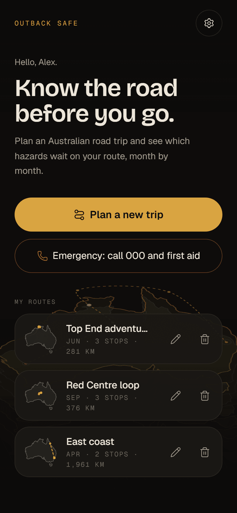<br><b>Home</b><br><small>Saved routes with mini maps</small></td>
  </tr>
</table>

### Planning a trip

<table>
  <tr>
    <td align="center">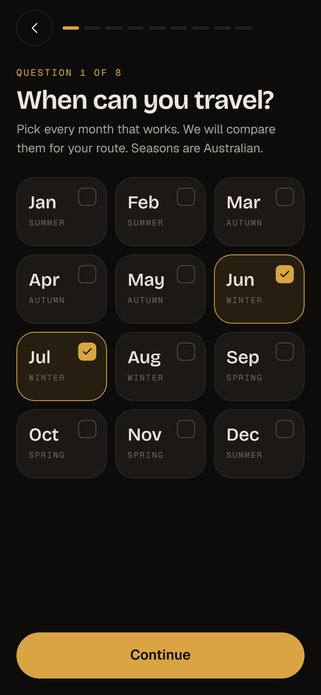<br><b>Pick your months</b><br><small>Compare several at once</small></td>
    <td align="center">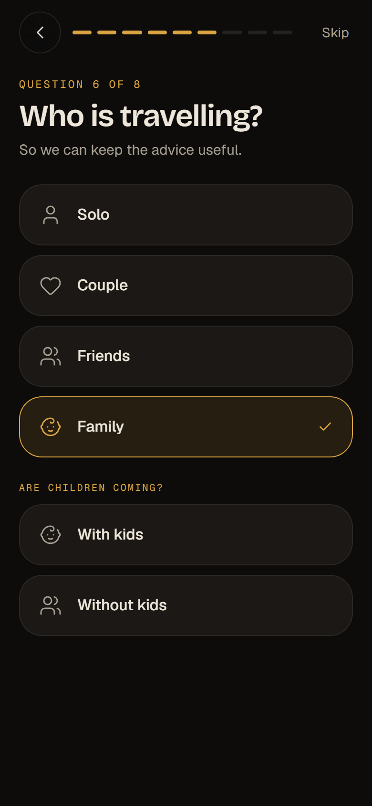<br><b>Family?</b><br><small>A follow-up asks about kids</small></td>
    <td align="center">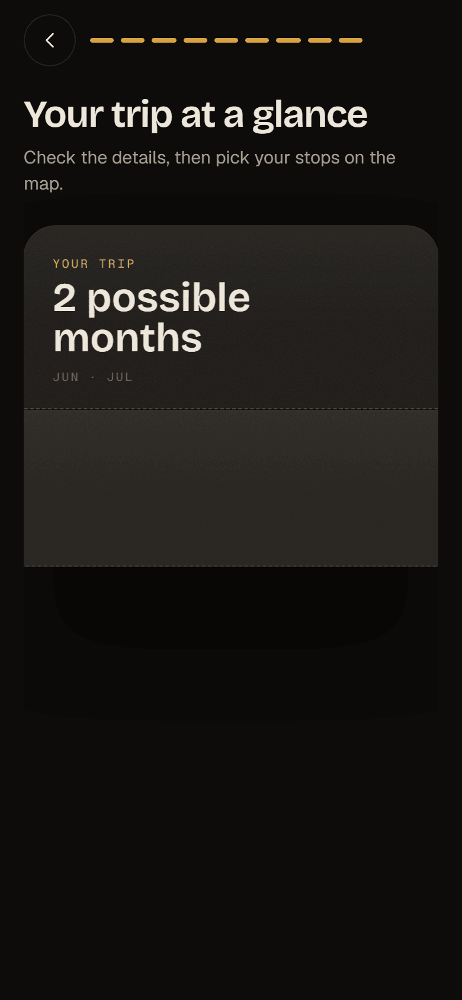<br><b>The letter unfolds</b><br><small>Tri-fold, in 3D</small></td>
    <td align="center">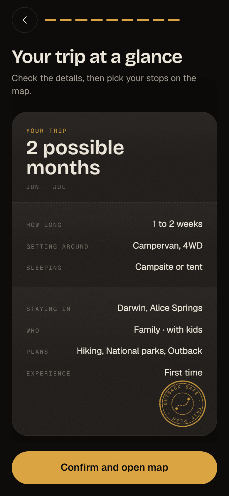<br><b>Your trip at a glance</b><br><small>Sealed with a stamp</small></td>
  </tr>
</table>

### Map, route and hazards

<table>
  <tr>
    <td align="center">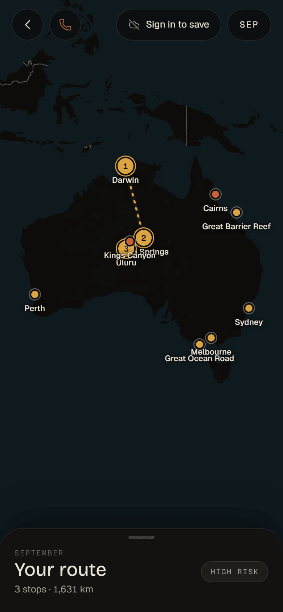<br><b>The map</b><br><small>Pins, route line</small></td>
    <td align="center">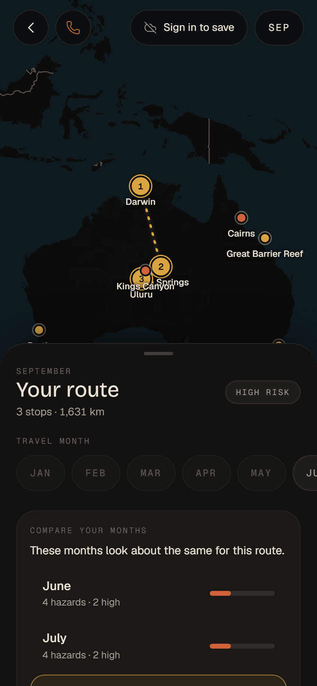<br><b>Bottom sheet</b><br><small>Drag to three heights</small></td>
    <td align="center">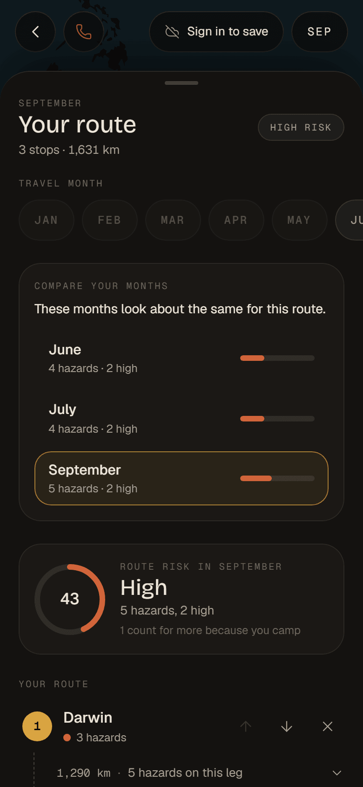<br><b>Your route</b><br><small>Risk ring, legs, ideas</small></td>
  </tr>
  <tr>
    <td align="center">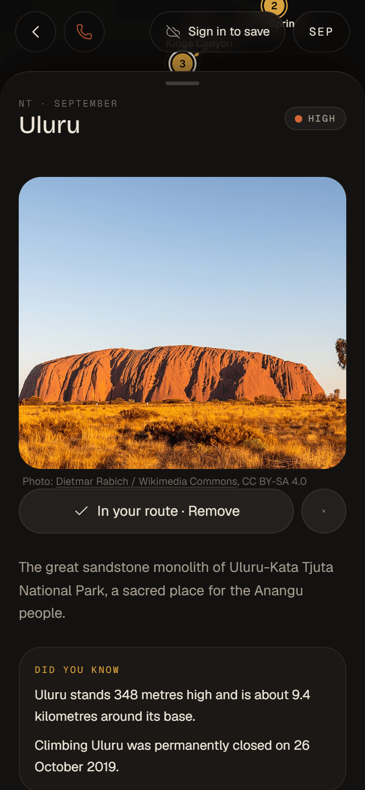<br><b>Place details</b><br><small>Big photo, facts, credit</small></td>
    <td align="center">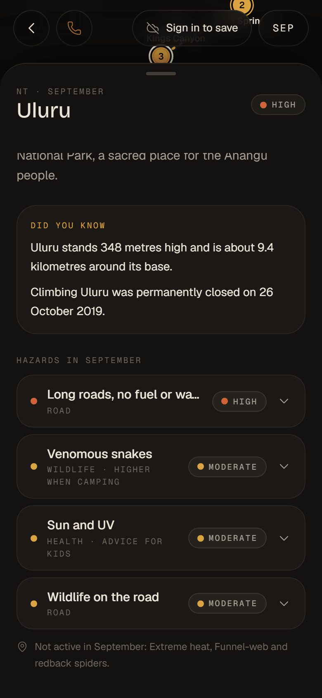<br><b>Hazards</b><br><small>For your month and plans</small></td>
    <td align="center">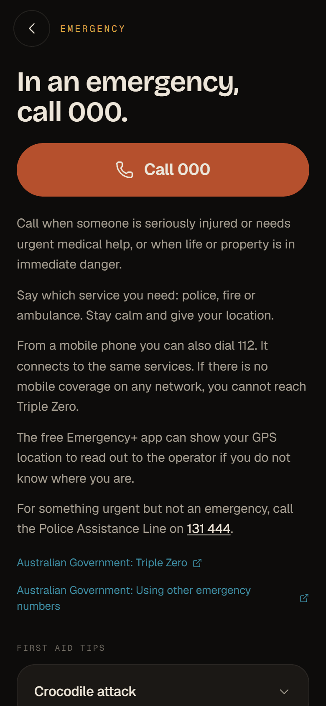<br><b>Emergency</b><br><small>Call 000, first aid</small></td>
  </tr>
</table>

</div>

## How it works

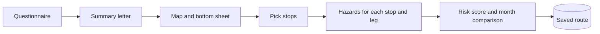

1. **Answer** a few questions. Only the travel months are required, and unanswered questions never hide a hazard.
2. **Check** the letter, then open the map.
3. **Pick stops** by tapping pins or the "Ideas near" list. Place pages show photos, facts and walk details.
4. **Read** the hazards for each stop and for the legs between them, and compare months.
5. **Save** the route to your account, or keep planning as a guest.

## How risk is calculated

1. For each stop we collect the hazards that are active in the chosen month.
2. Trip answers filter them: road hazards only apply if you drive (rental car, campervan or 4WD), and activity hazards only apply if they match what you plan to do. Unanswered questions never hide anything.
3. Each hazard adds its severity (1 low, 2 moderate, 3 high). Camping hazards add one extra point if you sleep in a campsite, tent or campervan.
4. The score compares the total with a busy trip of 30 points (capped at 100). The level is the highest severity found, so one high hazard always shows as **High**.

A route with one stop works the same way; there are just no legs.

**Children.** Choosing "Family" asks whether children are coming. If so, hazards that have a sourced `kidsNote` (sun and UV, extreme heat, saltwater crocodiles) show an extra "With children" box with its own source. This is advice only and does not change the score. A hazard only gets a `kidsNote` when a readable official source says it.

**Comparing months.** You can pick every month that works for you. Once the route has stops, the same calculation runs for each of those months. The month with the lowest score is marked "Best"; ties are broken by fewer high hazards, then fewer hazards in total. If the best months are identical, no month is marked. For long trips you can enter the number of weeks and an optional start date, but hazards are still shown for one active month at a time (no multi-month span logic yet).

## What is in the data

| | |
| --- | --- |
| **Places** | 62 across NT, NSW, QLD, VIC and WA: 8 base cities (Sydney, Cairns, Darwin, Alice Springs, Perth, Yulara, Kings Canyon, Melbourne), national parks, waterfalls, beaches, lookouts and 32 walks with sourced distance, time and grade |
| **Hazards** | 14, each with severity, active months, advice, first aid and sources |
| **Sources** | About 100 source links across hazards and places (government agencies, park services, health bodies, Wikipedia) |
| **Photos** | Free-licence Wikimedia Commons photos for every place, with photographer, licence and file link shown under each photo |

<details>
<summary>The 14 hazards</summary>

<br>

| Hazard | Category |
| --- | --- |
| Saltwater crocodiles | Wildlife |
| Box jellyfish and Irukandji | Wildlife |
| Sharks | Wildlife |
| Venomous snakes | Wildlife |
| Funnel-web and redback spiders | Wildlife |
| Rip currents | Water |
| Extreme heat | Weather |
| Tropical cyclones | Weather |
| Flash floods and flooded roads | Weather |
| Bushfires (NSW and Victoria are separate, because each state declares its own fire danger period) | Weather |
| Sun and UV | Health |
| Wildlife on the road | Road |
| Long roads, no fuel or water | Road |

</details>

### Data rules

- Every place in `data/places.json` carries its own `sources`. Walk distances, times and grades are copied as the source states them, and anything a source does not give is left out rather than guessed.
- Facts that could not be backed by a readable source are not included. Nothing is invented.
- Pin coordinates come from Wikipedia and OpenStreetMap (ODbL).
- Coastal places carry sharks and rips from their region; inland walks list `skipHazards` so those are left out.
- `suits` (who a place is good for) is an editorial suggestion, not a source fact. Everything else on a place is copied from its sources.
- Day trips and walks only show on the map from a regional zoom on (about a quarter of the country), or when you open them from the "Ideas near" list. Pins that would overlap are thinned out: main places and route stops always stay, sights come before walks, and more pins appear the closer you zoom.

## Tech stack

| Area | Tools |
| --- | --- |
| Framework | [Next.js 16](https://nextjs.org) (App Router, Turbopack), React 19, TypeScript |
| Styling | Tailwind CSS 4 with design tokens in `@theme`; Bricolage Grotesque, Geist and Geist Mono via `next/font` |
| Map | [MapLibre GL JS](https://maplibre.org) with the CARTO dark basemap (no API key) |
| Motion | [`motion`](https://motion.dev) plus plain CSS 3D (no WebGL) |
| State | [zustand](https://zustand-demo.pmnd.rs) with persistence (`outback-safe-trip`, versioned migrations) |
| Accounts and storage | Firebase Auth (email and password) and Firestore |
| Icons | [Lucide](https://lucide.dev) |
| PWA | Web manifest and a hand-written service worker |
| Hosting | [Vercel](https://vercel.com) |

## Project structure

```text
app/                    Routes: home, onboarding, map, emergency, manifest
components/
  auth/                 Auth provider, 3D login scene, arrival animation
  home/                 Home and login screens, route list, settings sheet
  loading/              Intro with the self-drawing Australia outline
  map/                  MapLibre map, zoom-based pin thinning, save control
  onboarding/           Questions, answer cards, tri-fold summary letter
  sheet/                Bottom sheet, route overview, place and hazard cards
  ui/                   Buttons, chips, dialogs, month picker, mini route
data/                   places.json, hazards.json, emergency.json
lib/                    Risk calculation, month comparison, suggestions, store
public/                 Icons, service worker, place photos
scripts/                Photo fetcher, contact sheet, icon generator
firestore.rules         Security rules: users only touch their own routes
```

## Getting started

You need **Node.js 24 LTS** (see `.nvmrc`).

```bash
git clone https://github.com/SnowyFox505/outback-safe.git
cd outback-safe
npm install
cp .env.example .env.local   # optional: only needed for sign-in and saving
npm run dev
```

Open <http://localhost:3000>. Without the Firebase variables the app runs in **guest mode**: you can plan trips and see hazards, but routes cannot be saved.

| Command | What it does |
| --- | --- |
| `npm run dev` | Start the development server |
| `npm run build` | Create the production build |
| `npm run start` | Serve the production build |
| `npm run lint` | Run ESLint |
| `node scripts/fetch-commons-image.mjs <placeId> "File:Title.jpg" "Alt text"` | Download a free-licence Commons photo and write its credit |
| `node scripts/contact-sheet.mjs out.jpg` | Build one overview image of all place photos |
| `node scripts/generate-icons.mjs` | Regenerate the PWA icons |

## Firebase setup

1. Create a project in the [Firebase console](https://console.firebase.google.com).
2. Build > Authentication > Sign-in method: enable **Email/Password**.
3. Build > Firestore Database: create a database (production mode), then paste the contents of `firestore.rules` into the Rules tab and publish.
4. Project settings > Your apps: add a **Web app** and copy the config values into `.env.local` (see `.env.example`).
5. Authentication > Settings > Authorized domains: add your production domain, for example `outback-safe.vercel.app`.
6. Set the same `NEXT_PUBLIC_FIREBASE_*` variables in Vercel (Project > Settings > Environment Variables), then redeploy.

<details>
<summary>Google sign-in and iPhone (optional)</summary>

<br>

Google sign-in is built into `AuthProvider` but hidden in the UI for now. If you switch it on, note that Safari blocks the third-party storage that Firebase's default sign-in helper needs. To avoid this, the production auth domain is the app's own domain and `next.config.ts` proxies `/__/auth/*` to `<project-id>.firebaseapp.com`.

- In Vercel set `NEXT_PUBLIC_FIREBASE_AUTH_DOMAIN=outback-safe.vercel.app`.
- In [Google Cloud console](https://console.cloud.google.com) > APIs & Services > Credentials > the "Web client (auto created by Google Service)": add `https://outback-safe.vercel.app/__/auth/handler` to **Authorized redirect URIs** and `https://outback-safe.vercel.app` to **Authorized JavaScript origins**.
- Locally, keep `NEXT_PUBLIC_FIREBASE_AUTH_DOMAIN=<project-id>.firebaseapp.com`.

</details>

### Data model

Routes are stored at `users/{uid}/routes/{routeId}` with `name`, `month`, `trip` (the questionnaire answers), `stops` (in order), `createdAt` and `updatedAt`. Security rules allow a user to read and write only their own routes, and limit a name to 80 characters and a route to 50 stops.

Signed-in users get auto-save by default (the route saves about 1.5 seconds after the last change). It can be switched off under Settings on the home screen, which brings back the manual Save/Update button.

## PWA and offline

- `app/manifest.ts` generates the web manifest (standalone, dark theme colour). Icons live in `public/icons/`.
- `public/sw.js` is a hand-written service worker. It caches the app pages and all scripts, styles and fonts they need, so the app opens offline. Pages are fetched network-first, so you always get the newest version when online.
- Offline, the map base tiles are not available (they load from CARTO), but pins, routes, hazards, the questionnaire and the emergency screen all work.
- Bump `VERSION` in `public/sw.js` to clear all old caches. The service worker only registers in production builds.
- On a phone, use "Add to Home Screen" to install it.

## Motion

- Animations use `motion` and plain CSS 3D. `prefers-reduced-motion` turns them into short fades.
- The intro draws the outline of Australia and plays on every cold start, and again when the app returns after more than 90 seconds in the background.
- The trip summary is a tri-fold letter that unfolds in 3D and ends with a stamp (`components/onboarding/TripSummary.tsx`).
- The login and home screens show Australia as stacked paper layers (`components/auth/LoginScene.tsx`). On login they tilt with the pointer; on home they breathe on their own. After signing in, the camera dives through the layers into home (`ArrivalOverlay.tsx`).

## Credits

- Map data © [OpenStreetMap](https://www.openstreetmap.org/copyright) contributors, © [CARTO](https://carto.com/attributions). The attribution always stays visible on the map.
- Place photos from [Wikimedia Commons](https://commons.wikimedia.org), each under a free licence and credited under the photo.
- Icons by [Lucide](https://lucide.dev).
- Hazard and place facts come from the public sources linked on each entry.

</details>

<details>
<summary><b>🇩🇪&nbsp; Deutsch</b></summary>

<br>

## Über das Projekt

**Outback Safe** ist eine dunkle, ruhige, mobile-first Web-App (als PWA installierbar) für alle, die mit dem Auto durch Australien fahren und wissen wollen, was sie erwartet. Du beantwortest ein paar Fragen zu deiner Reise, wählst Stopps auf einer Karte, und die App zeigt dir die Gefahren, die für **deinen** Monat, **deine** Art zu reisen und **deine** Pläne wichtig sind: von Salzwasserkrokodilen und Quallensaison im tropischen Norden bis zu Hitze, Buschfeuern und leeren Straßen im Roten Zentrum.

Jede Gefahr wird einfach erklärt, sagt, was zu tun ist, verlinkt ihre öffentlichen Quellen, und die ganze Reise wird zu einem einfachen Risikowert zusammengefasst, den du über die Monate vergleichen kannst.

> [!WARNING]
> **Keine offizielle Sicherheitsberatung.** Die Gefahreninfos sind ein Leitfaden auf Basis öffentlicher Quellen (bei jeder Gefahr aufgelistet). Befolge immer die Schilder vor Ort, Ranger und Rettungsdienste. Die Notrufnummer in Australien ist **000**.

## Highlights

- **Reisefragebogen** mit acht kurzen Fragen: Monate, Dauer, Fortbewegung, Unterkunft, Basisstädte, wer reist (mit Nachfrage zu Kindern), Aktivitäten und Erfahrung. Am Ende klappt sich ein dreifach gefalteter Brief in 3D auf und bekommt einen Stempel.
- **Interaktive dunkle Karte** (MapLibre) mit 62 Orten in fünf Bundesstaaten und Territorien. Tippen fügt Stopps hinzu, die gepunktete Route wird gezeichnet, und beim Hineinzoomen erscheinen mehr Pins. Überlappende Pins werden automatisch ausgedünnt.
- **Gefahren, die zu deiner Reise passen.** 14 Gefahren, jeweils mit Schweregrad, aktiven Monaten, Verhaltenstipps, Erster Hilfe und Quellen. Gefiltert nach Monat, Fortbewegung, Aktivitäten und Schlafplatz.
- **Risikoring und Monatsvergleich.** Ein Wert für die ganze Route und ein direkter Vergleich aller möglichen Reisemonate, der beste Monat ist markiert.
- **Ortsseiten** mit Foto, Bildnachweis, Fun Facts, Anfahrtshinweisen und belegten Wanderdaten (Länge, Dauer, Schwierigkeitsgrad).
- **Ideen rund um deine Basisstadt.** Tagesausflüge und Wanderungen, sortiert danach, für wen sie passen.
- **Reisen mit Kindern.** Wer „Family“ wählt, wird nach Kindern gefragt. Bei den Gefahren, zu denen eine offizielle Quelle etwas sagt, erscheint zusätzlich ein belegter Hinweis für Kinder.
- **Gespeicherte Routen.** Mit E-Mail und Passwort anmelden, und die Routen speichern sich kurz nach der letzten Änderung von selbst.
- **Notfall-Bildschirm** mit Anruf bei 000 per Fingertipp und Erste-Hilfe-Schritten bei Krokodilangriff, Schlangenbiss, Quallenstichen, Hitzschlag, Buschfeuer und Brandungsrückströmung.
- **Funktioniert offline.** Ein von Hand geschriebener Service Worker speichert die App, damit Routen, Gefahren und der Notfall-Bildschirm auch ohne Verbindung laufen.
- **Hochwertige Animationen** mit CSS 3D und `motion` (ohne WebGL): ein atmendes Australien aus Papierschichten auf Login und Startseite, ein Kameraflug nach dem Anmelden und der sich entfaltende Brief. Berücksichtigt `prefers-reduced-motion`.

## Screenshots

<div align="center">

### Erste Schritte

<table>
  <tr>
    <td align="center"><br><b>Intro</b><br><small>Australien zeichnet sich selbst</small></td>
    <td align="center"><br><b>Anmelden</b><br><small>Reliefschichten, schwebende Route</small></td>
    <td align="center"><br><b>Start</b><br><small>Gespeicherte Routen mit Minikarten</small></td>
  </tr>
</table>

### Reise planen

<table>
  <tr>
    <td align="center"><br><b>Monate wählen</b><br><small>Mehrere gleichzeitig vergleichen</small></td>
    <td align="center"><br><b>Familie?</b><br><small>Eine Nachfrage fragt nach Kindern</small></td>
    <td align="center"><br><b>Der Brief klappt auf</b><br><small>Dreifach gefaltet, in 3D</small></td>
    <td align="center"><br><b>Deine Reise im Überblick</b><br><small>Mit Stempel besiegelt</small></td>
  </tr>
</table>

### Karte, Route und Gefahren

<table>
  <tr>
    <td align="center"><br><b>Die Karte</b><br><small>Pins, Routenlinie</small></td>
    <td align="center"><br><b>Bottom Sheet</b><br><small>Auf drei Höhen ziehbar</small></td>
    <td align="center"><br><b>Deine Route</b><br><small>Risikoring, Etappen, Ideen</small></td>
  </tr>
  <tr>
    <td align="center"><br><b>Ortsdetails</b><br><small>Großes Foto, Fakten, Bildnachweis</small></td>
    <td align="center"><br><b>Gefahren</b><br><small>Für deinen Monat und deine Pläne</small></td>
    <td align="center"><br><b>Notfall</b><br><small>000 anrufen, Erste Hilfe</small></td>
  </tr>
</table>

</div>

## So funktioniert es

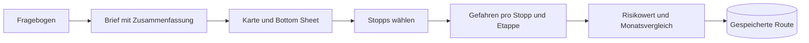

1. **Beantworte** ein paar Fragen. Nur die Reisemonate sind Pflicht, und unbeantwortete Fragen verstecken nie eine Gefahr.
2. **Prüfe** den Brief und öffne die Karte.
3. **Wähle Stopps** über die Pins oder die Liste „Ideas near“. Die Ortsseiten zeigen Fotos, Fakten und Wanderdetails.
4. **Lies** die Gefahren für jeden Stopp und für die Etappen dazwischen und vergleiche die Monate.
5. **Speichere** die Route in deinem Konto oder plane weiter als Gast.

## So wird das Risiko berechnet

1. Für jeden Stopp sammeln wir die Gefahren, die im gewählten Monat aktiv sind.
2. Die Reiseantworten filtern sie: Straßengefahren gelten nur, wenn du fährst (Mietwagen, Campervan oder 4WD), und Aktivitätsgefahren nur, wenn sie zu deinen Plänen passen. Unbeantwortete Fragen verstecken nie etwas.
3. Jede Gefahr zählt ihren Schweregrad (1 niedrig, 2 mittel, 3 hoch). Camping-Gefahren zählen einen Punkt mehr, wenn du auf einem Campingplatz, im Zelt oder im Campervan schläfst.
4. Der Wert vergleicht die Summe mit einer anstrengenden Reise von 30 Punkten (höchstens 100). Die Stufe ist der höchste gefundene Schweregrad, eine hohe Gefahr zeigt also immer **High**.

Eine Route mit nur einem Stopp funktioniert genauso, es gibt nur keine Etappen.

**Kinder.** Wer „Family“ wählt, wird gefragt, ob Kinder mitreisen. Falls ja, zeigen Gefahren mit einem belegten `kidsNote` (Sonne und UV, extreme Hitze, Salzwasserkrokodile) eine zusätzliche Box „With children“ mit eigener Quelle. Das ist nur ein Hinweis und ändert den Wert nicht. Eine Gefahr bekommt nur dann einen `kidsNote`, wenn eine lesbare offizielle Quelle es sagt.

**Monate vergleichen.** Du kannst alle Monate wählen, die für dich passen. Sobald die Route Stopps hat, läuft dieselbe Berechnung für jeden dieser Monate. Der Monat mit dem niedrigsten Wert wird als „Best“ markiert; bei Gleichstand entscheiden weniger hohe Gefahren, dann weniger Gefahren insgesamt. Sind die besten Monate identisch, wird keiner markiert. Bei langen Reisen kannst du die Wochenzahl und ein optionales Startdatum angeben, die Gefahren werden aber weiterhin für einen aktiven Monat gleichzeitig gezeigt (noch keine Logik für mehrere Monate am Stück).

## Was in den Daten steckt

| | |
| --- | --- |
| **Orte** | 62 in NT, NSW, QLD, VIC und WA: 8 Basisstädte (Sydney, Cairns, Darwin, Alice Springs, Perth, Yulara, Kings Canyon, Melbourne), Nationalparks, Wasserfälle, Strände, Aussichtspunkte und 32 Wanderungen mit belegter Länge, Dauer und Schwierigkeit |
| **Gefahren** | 14, jeweils mit Schweregrad, aktiven Monaten, Verhaltenstipps, Erster Hilfe und Quellen |
| **Quellen** | Rund 100 Quellenlinks bei Gefahren und Orten (Behörden, Parkverwaltungen, Gesundheitsstellen, Wikipedia) |
| **Fotos** | Frei lizenzierte Wikimedia-Commons-Fotos für jeden Ort, mit Fotograf, Lizenz und Dateilink unter jedem Foto |

<details>
<summary>Die 14 Gefahren</summary>

<br>

| Gefahr | Kategorie |
| --- | --- |
| Salzwasserkrokodile | Tiere |
| Würfelquallen und Irukandji | Tiere |
| Haie | Tiere |
| Giftschlangen | Tiere |
| Trichternetz- und Rotrückenspinnen | Tiere |
| Rip Currents (Rückströmungen) | Wasser |
| Extreme Hitze | Wetter |
| Tropische Wirbelstürme | Wetter |
| Sturzfluten und überflutete Straßen | Wetter |
| Buschfeuer (NSW und Victoria getrennt, weil jeder Staat seine eigene Brandgefahrenzeit ausruft) | Wetter |
| Sonne und UV | Gesundheit |
| Wildtiere auf der Straße | Straße |
| Lange Strecken ohne Sprit oder Wasser | Straße |

</details>

### Regeln für die Daten

- Jeder Ort in `data/places.json` hat seine eigenen `sources`. Wanderlängen, Zeiten und Schwierigkeitsgrade werden so übernommen, wie die Quelle sie nennt, und was eine Quelle nicht angibt, wird weggelassen statt geraten.
- Fakten, die sich nicht mit einer lesbaren Quelle belegen ließen, sind nicht enthalten. Es wird nichts erfunden.
- Die Pin-Koordinaten stammen von Wikipedia und OpenStreetMap (ODbL).
- Orte an der Küste erben Haie und Rip Currents aus ihrer Region; Wanderungen im Landesinneren führen `skipHazards`, damit diese wegfallen.
- `suits` (für wen ein Ort passt) ist ein redaktioneller Vorschlag, keine Quellenangabe. Alles andere an einem Ort ist aus den Quellen übernommen.
- Tagesausflüge und Wanderungen erscheinen erst ab einer regionalen Zoomstufe (etwa ein Viertel des Landes) oder wenn du sie über „Ideas near“ öffnest. Überlappende Pins werden ausgedünnt: Hauptorte und Routenstopps bleiben immer, Sehenswürdigkeiten kommen vor Wanderungen, und je näher du zoomst, desto mehr Pins erscheinen.

## Technik

| Bereich | Werkzeuge |
| --- | --- |
| Framework | [Next.js 16](https://nextjs.org) (App Router, Turbopack), React 19, TypeScript |
| Styling | Tailwind CSS 4 mit Design-Tokens in `@theme`; Bricolage Grotesque, Geist und Geist Mono über `next/font` |
| Karte | [MapLibre GL JS](https://maplibre.org) mit der dunklen CARTO-Basiskarte (ohne API-Key) |
| Animation | [`motion`](https://motion.dev) und reines CSS 3D (ohne WebGL) |
| Zustand | [zustand](https://zustand-demo.pmnd.rs) mit Persistenz (`outback-safe-trip`, versionierte Migrationen) |
| Konten und Speicher | Firebase Auth (E-Mail und Passwort) und Firestore |
| Icons | [Lucide](https://lucide.dev) |
| PWA | Web-Manifest und ein von Hand geschriebener Service Worker |
| Hosting | [Vercel](https://vercel.com) |

## Projektstruktur

```text
app/                    Routen: Start, Onboarding, Karte, Notfall, Manifest
components/
  auth/                 Auth-Provider, 3D-Login-Szene, Ankunftsanimation
  home/                 Start- und Login-Bildschirm, Routenliste, Einstellungen
  loading/              Intro mit der sich selbst zeichnenden Australien-Kontur
  map/                  MapLibre-Karte, zoomabhängiges Ausdünnen der Pins
  onboarding/           Fragen, Antwortkarten, dreifach gefalteter Brief
  sheet/                Bottom Sheet, Routenübersicht, Orts- und Gefahrenkarten
  ui/                   Buttons, Chips, Dialoge, Monatsauswahl, Minikarte
data/                   places.json, hazards.json, emergency.json
lib/                    Risikoberechnung, Monatsvergleich, Vorschläge, Store
public/                 Icons, Service Worker, Ortsfotos
scripts/                Foto-Download, Kontaktbogen, Icon-Generator
firestore.rules         Sicherheitsregeln: Nutzer sehen nur ihre eigenen Routen
```

## Loslegen

Du brauchst **Node.js 24 LTS** (siehe `.nvmrc`).

```bash
git clone https://github.com/SnowyFox505/outback-safe.git
cd outback-safe
npm install
cp .env.example .env.local   # optional: nur für Anmeldung und Speichern nötig
npm run dev
```

Öffne <http://localhost:3000>. Ohne die Firebase-Variablen läuft die App im **Gastmodus**: Du kannst Reisen planen und Gefahren sehen, aber Routen lassen sich nicht speichern.

| Befehl | Was er tut |
| --- | --- |
| `npm run dev` | Entwicklungsserver starten |
| `npm run build` | Produktions-Build erstellen |
| `npm run start` | Produktions-Build ausliefern |
| `npm run lint` | ESLint ausführen |
| `node scripts/fetch-commons-image.mjs <placeId> "File:Title.jpg" "Alt text"` | Frei lizenziertes Commons-Foto laden und den Bildnachweis schreiben |
| `node scripts/contact-sheet.mjs out.jpg` | Ein Übersichtsbild aller Ortsfotos erstellen |
| `node scripts/generate-icons.mjs` | PWA-Icons neu erzeugen |

## Firebase einrichten

1. Lege in der [Firebase-Konsole](https://console.firebase.google.com) ein Projekt an.
2. Build > Authentication > Sign-in method: **E-Mail/Passwort** aktivieren.
3. Build > Firestore Database: Datenbank anlegen (Produktionsmodus), dann den Inhalt von `firestore.rules` im Tab „Rules“ einfügen und veröffentlichen.
4. Projekteinstellungen > Deine Apps: eine **Web-App** hinzufügen und die Konfigurationswerte in `.env.local` übernehmen (siehe `.env.example`).
5. Authentication > Settings > Authorized domains: deine Produktionsdomain eintragen, zum Beispiel `outback-safe.vercel.app`.
6. Dieselben `NEXT_PUBLIC_FIREBASE_*`-Variablen in Vercel setzen (Project > Settings > Environment Variables) und neu deployen.

<details>
<summary>Google-Anmeldung und iPhone (optional)</summary>

<br>

Die Google-Anmeldung ist in `AuthProvider` eingebaut, aber in der Oberfläche vorerst versteckt. Wenn du sie einschaltest: Safari blockiert den Drittanbieter-Speicher, den der Standard-Helfer von Firebase braucht. Deshalb ist die Auth-Domain in Produktion die eigene Domain der App, und `next.config.ts` leitet `/__/auth/*` an `<project-id>.firebaseapp.com` weiter.

- In Vercel `NEXT_PUBLIC_FIREBASE_AUTH_DOMAIN=outback-safe.vercel.app` setzen.
- In der [Google Cloud Console](https://console.cloud.google.com) > APIs & Services > Credentials > „Web client (auto created by Google Service)“: `https://outback-safe.vercel.app/__/auth/handler` unter **Authorized redirect URIs** und `https://outback-safe.vercel.app` unter **Authorized JavaScript origins** eintragen.
- Lokal bleibt es bei `NEXT_PUBLIC_FIREBASE_AUTH_DOMAIN=<project-id>.firebaseapp.com`.

</details>

### Datenmodell

Routen liegen unter `users/{uid}/routes/{routeId}` mit `name`, `month`, `trip` (die Antworten des Fragebogens), `stops` (der Reihe nach), `createdAt` und `updatedAt`. Die Sicherheitsregeln erlauben jedem Nutzer nur Lesen und Schreiben seiner eigenen Routen und begrenzen einen Namen auf 80 Zeichen und eine Route auf 50 Stopps.

Angemeldete Nutzer haben Auto-Save standardmäßig an (die Route speichert etwa 1,5 Sekunden nach der letzten Änderung). Unter Settings auf der Startseite lässt es sich ausschalten, dann kommt der manuelle Save/Update-Button zurück.

## PWA und Offline

- `app/manifest.ts` erzeugt das Web-Manifest (Standalone, dunkle Themenfarbe). Die Icons liegen in `public/icons/`.
- `public/sw.js` ist ein von Hand geschriebener Service Worker. Er speichert die App-Seiten und alle nötigen Skripte, Styles und Schriften, damit die App offline startet. Seiten werden zuerst über das Netzwerk geladen, du bekommst online also immer die neueste Version.
- Offline fehlen die Kartenkacheln der Basiskarte (sie kommen von CARTO), aber Pins, Routen, Gefahren, der Fragebogen und der Notfall-Bildschirm funktionieren.
- `VERSION` in `public/sw.js` erhöhen, um alle alten Caches zu leeren. Der Service Worker registriert sich nur in Produktions-Builds.
- Auf dem Handy installierst du die App über „Zum Home-Bildschirm“.

## Animationen

- Die Animationen nutzen `motion` und reines CSS 3D. `prefers-reduced-motion` macht daraus kurze Überblendungen.
- Das Intro zeichnet die Kontur von Australien und läuft bei jedem Kaltstart sowie erneut, wenn die App nach mehr als 90 Sekunden im Hintergrund zurückkommt.
- Die Zusammenfassung ist ein dreifach gefalteter Brief, der sich in 3D entfaltet und mit einem Stempel endet (`components/onboarding/TripSummary.tsx`).
- Login und Startseite zeigen Australien als gestapelte Papierschichten (`components/auth/LoginScene.tsx`). Beim Login neigen sie sich mit dem Zeiger, auf der Startseite atmen sie von selbst. Nach der Anmeldung fliegt die Kamera durch die Schichten auf die Startseite (`ArrivalOverlay.tsx`).

## Quellen und Bildnachweise

- Kartendaten © [OpenStreetMap](https://www.openstreetmap.org/copyright)-Mitwirkende, © [CARTO](https://carto.com/attributions). Die Quellenangabe bleibt auf der Karte immer sichtbar.
- Ortsfotos von [Wikimedia Commons](https://commons.wikimedia.org), jeweils unter freier Lizenz und unter dem Foto genannt.
- Icons von [Lucide](https://lucide.dev).
- Fakten zu Gefahren und Orten stammen aus den öffentlichen Quellen, die bei jedem Eintrag verlinkt sind.

</details>

<br>

<div align="center">

<sub>Hazard information is a guide, not official safety advice. In an emergency in Australia, call <b>000</b>.</sub>

</div>
